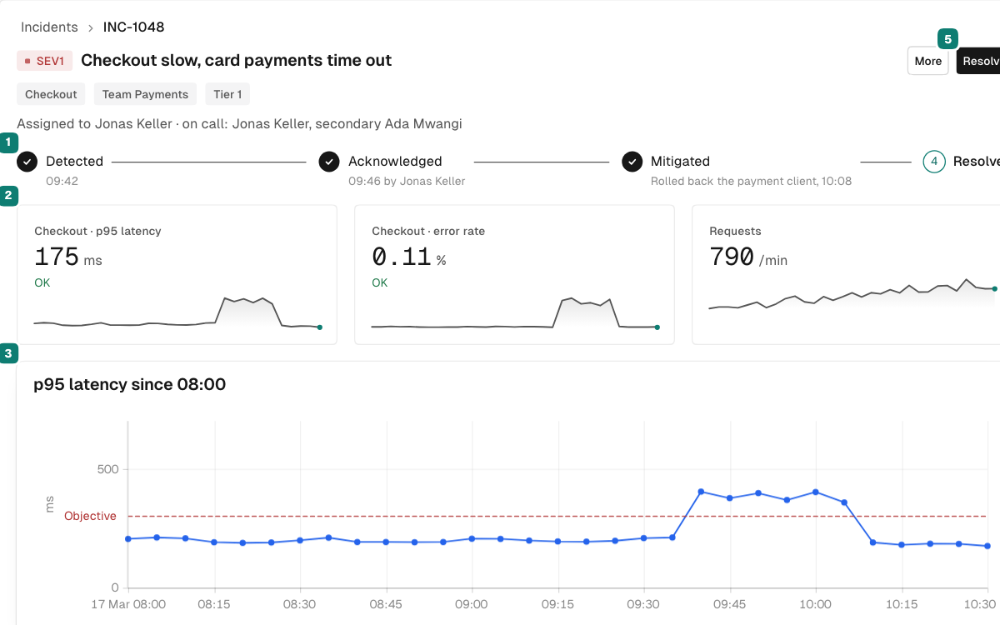
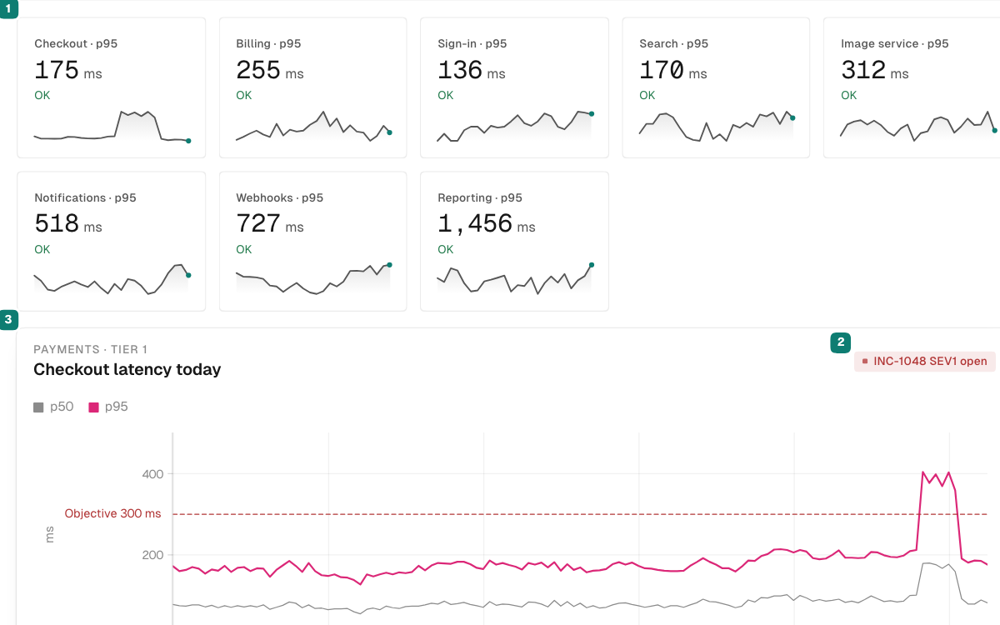
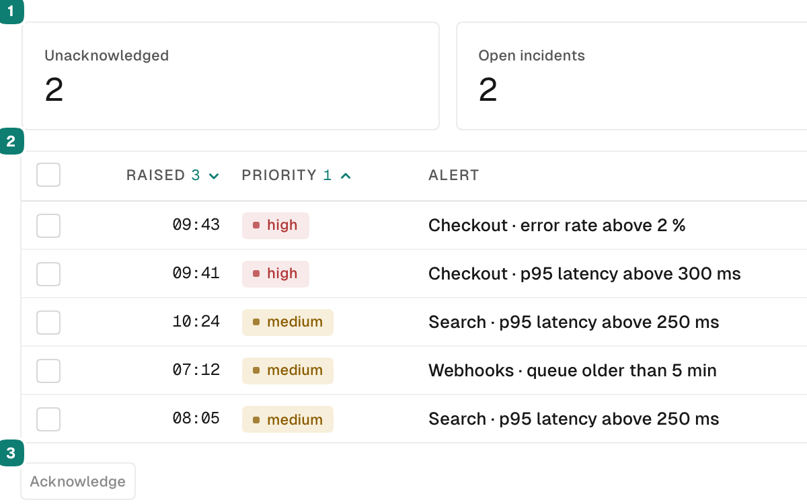
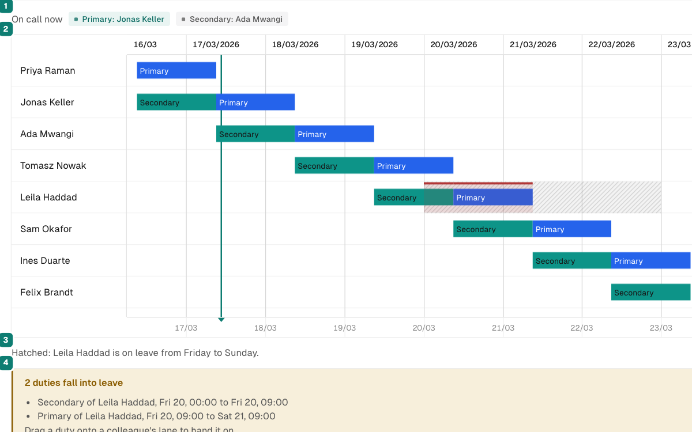
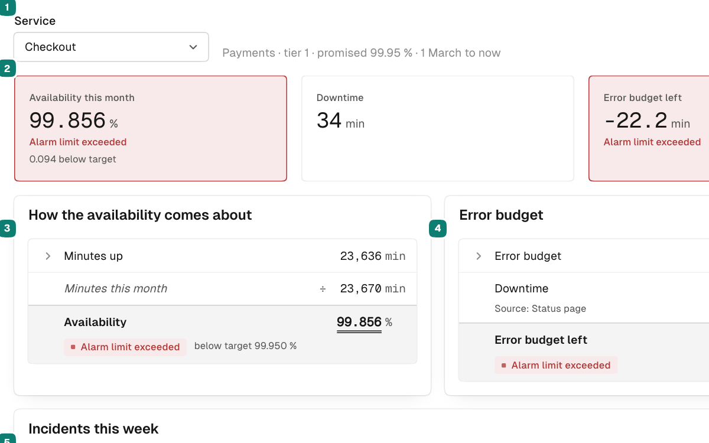
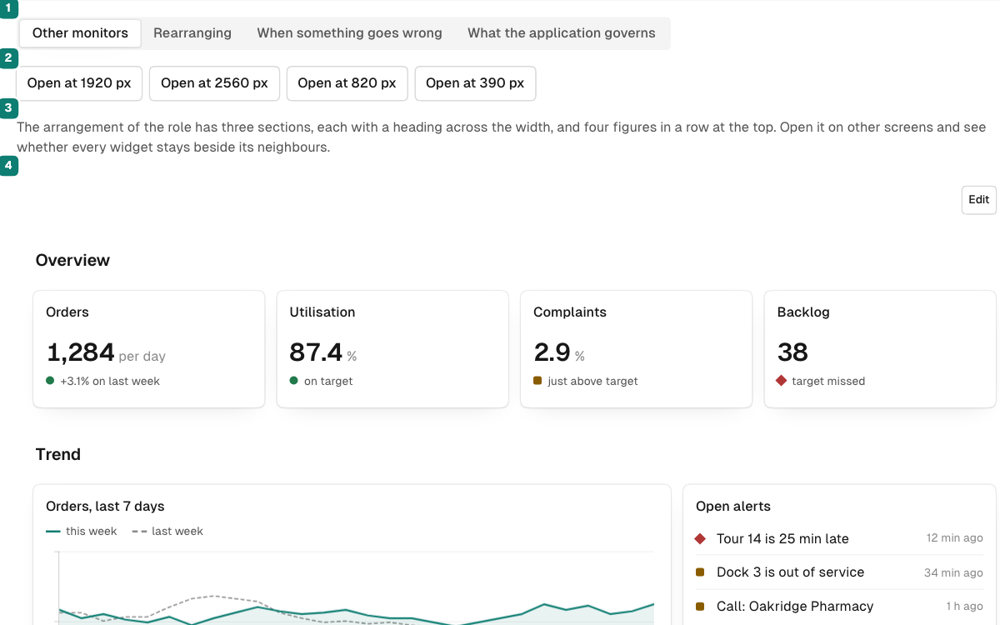

# umriss-ui

React components, canvas charts, a data table, a Gantt-style schedule, a calculation view and a dashboard readers arrange for
data-dense applications — dashboards, monitoring, planning, and the tools in
which people read a lot of data and act on it (ADR-0035). One pnpm workspace. The demos show them in five invented worlds: a SaaS
platform's operations, a parcel carrier, a company's controlling, a studio's
planning, and a tile works. The design language is **precise and quiet, with
palpable quality**: depth comes from soft shadows and fine light edges, not from
hard outlines or effects.

## The packages

| Package | Version | What it is |
|---|---|---|
| [`@umriss-ui/core`](packages/core/README.md) | 0.46.0 | The component library — forms, overlays, structure, the tree, the command palette. The package you install first |
| [`@umriss-ui/charts`](packages/charts/README.md) | 0.46.0 | Canvas charts — few kinds, drawn well. Depends on nothing but React |
| [`@umriss-ui/table`](packages/table/README.md) | 0.46.0 | The table, declared the way it reads: columns as JSX, typed against their rows — filtering by column and by row, grouping, tree rows and aggregates in a pure model. Takes `@umriss-ui/core` as a peer |
| [`@umriss-ui/schedule`](packages/schedule/README.md) | 0.46.0 | The schedule: subtasks on lanes over time, with dependencies, blocked time, findings and controlled editing. Takes `@umriss-ui/core` and `@umriss-ui/charts` as peers |
| [`@umriss-ui/calculation`](packages/calculation/README.md) | 0.46.0 | A calculation a reader can follow and redo: a derivation written as it is shown, evaluated by the library, in one metric or several side by side. Takes `@umriss-ui/core` as a peer |
| [`@umriss-ui/dashboard`](packages/dashboard/README.md) | 0.46.0 | Widgets a developer declares and a reader arranges: a sequence at named sizes, packed on twelve columns, edited as a draft with undo, the arrangement the application's to keep. Takes `@umriss-ui/core` as a peer |
| `@umriss-ui/demo` | — | The private shell all six demos are built from. Never published |

All six published packages are released under the npm tag `latest`, so a plain
`pnpm add` installs them.

`core` names the package you install first, not a layer the others sit on:
`@umriss-ui/charts` depends on nothing and will keep depending on nothing,
`@umriss-ui/table` enters `core` by its public entry only (ADR-0016), and
`@umriss-ui/schedule` enters `core` and `charts` the same way (ADR-0022), and
`@umriss-ui/calculation` and `@umriss-ui/dashboard` enter `core` alone.

## See it running

The documentation is the demos. They run on your machine, at the version you
choose; there is no hosted site.

<table>
<tr>
<td align="center"><a href="packages/core/README.md"><picture><source media="(prefers-color-scheme: dark)" srcset="scripts/previews/core-dark.png"></picture><br><code>@umriss-ui/core</code></a></td>
<td align="center"><a href="packages/charts/README.md"><picture><source media="(prefers-color-scheme: dark)" srcset="scripts/previews/charts-dark.png"></picture><br><code>@umriss-ui/charts</code></a></td>
</tr>
<tr>
<td align="center"><a href="packages/table/README.md"><picture><source media="(prefers-color-scheme: dark)" srcset="scripts/previews/table-dark.png"></picture><br><code>@umriss-ui/table</code></a></td>
<td align="center"><a href="packages/schedule/README.md"><picture><source media="(prefers-color-scheme: dark)" srcset="scripts/previews/schedule-dark.png"></picture><br><code>@umriss-ui/schedule</code></a></td>
</tr>
<tr>
<td align="center"><a href="packages/calculation/README.md"><picture><source media="(prefers-color-scheme: dark)" srcset="scripts/previews/calculation-dark.png"></picture><br><code>@umriss-ui/calculation</code></a></td>
<td align="center"><a href="packages/dashboard/README.md"><picture><source media="(prefers-color-scheme: dark)" srcset="scripts/previews/dashboard-dark.png"></picture><br><code>@umriss-ui/dashboard</code></a></td>
</tr>
</table>

Three commands open it. They need Node 22 and pnpm 9 (`corepack enable` gives
you the pnpm the repository names):

```bash
git clone --branch core-v0.46.0 https://github.com/romanhaendler/umriss-ui.git
cd umriss-ui && pnpm install
pnpm start
```

`pnpm start` builds the site and serves it at <http://localhost:4170/umriss-ui/>;
it prints the address when it is ready. Replace the tag with the version you
installed: tags are `<package>-v<version>`, and all six packages share one
number, so any package's tag opens the whole site at that version, from
`0.41.1` on (an older tag has no `pnpm start`). `main`
documents what is not released yet. The same documentation travels inside every
package as `docs/llms-full.md`, readable without a clone.

The demo **is** the documentation for the components. Every page shows running
examples together with the source that produced them and a props table generated
from `src/` — there is no prose description of a component that could drift away
from the component. Every row of a props table links the examples that show it,
and the build stops at a prop no example shows, unless its package names it
as an exception with the reason. 27 core pages open with a configurator. Each
package has an API index of every export; one search (⌘K) finds pages, props,
exports, tokens and wording keys across all six packages;
the header switches the examples between English and German (the charts take
German per chart, so their demo has no switch); and every page has a Markdown
twin, listed in each package's `llms.txt`. The design language, the standards,
what umriss-ui is not and each package's changelog are pages of the same site
(ADR-0046).

## Quick start

```bash
pnpm add @umriss-ui/core
```

```tsx
import { Button, Card } from "@umriss-ui/core";
```

That is the whole setup. The package's JavaScript loads its own stylesheet, and
that stylesheet touches nothing but the library's own elements: no rule on
`html`, `body` or `*`, no `color-scheme` on the document (ADR-0021). Everything
lies in the cascade layers `umriss.tokens`, `umriss.base` and
`umriss.components`, so an application's own CSS always wins, and every token
can be overridden:

```css
:root {
  --u-font-sans: "Inter", system-ui, sans-serif;
  --u-color-accent: #0f766e;
}
```

**Light and dark** follow the standard `color-scheme` the application sets —
most theme switchers already do; one of your own writes
`html.dark { color-scheme: dark }`. **Fonts** are not loaded: Geist is
recommended and used when present (`@fontsource/geist-sans`,
`@fontsource/geist-mono`), the system fonts otherwise. **Browsers:** Chrome 123,
Firefox 120, Safari 17.5 or newer — the tokens use `light-dark()`.

## The demos

After a package's first scenario changes, `pnpm previews` renews the pictures above
from the site `pnpm build:site` builds (`scripts/previews/`, checked in).

For working on one demo:

```bash
pnpm install
pnpm dev:core      # port 4173
pnpm dev:charts    # port 4174
pnpm dev:table     # port 4175
pnpm dev:schedule  # port 4176
pnpm dev:calculation  # port 4177
pnpm dev:dashboard    # port 4178
```

## Where the documentation is

* **[`docs/README.md`](docs/README.md)** — the map: which document answers which
  question. Start there.
* **[`CONTEXT.md`](CONTEXT.md)** — the shared vocabulary. One concept, one word,
  and the words it may not collide with.
* **[`docs/adr/`](docs/adr/README.md)** — the decisions, with the arguments that
  produced them.
* **[`CONTRIBUTING.md`](CONTRIBUTING.md)** — setup, commands, and how work is
  organised here.

**For a coding agent**, an installable skill points it at the documentation above
and states the rules it would otherwise get wrong (`skills/umriss-ui/SKILL.md`):

```bash
npx skills add romanhaendler/umriss-ui --skill umriss-ui
```

## Maturity

The six packages are released together under one number, which is `0.x` for now (from `0.34.0`, the dashboard from `0.40.0`). A peer is named `^0.x.0`, so a minor moves the peer ranges and a patch does not; a rename keeps its old name for one further minor, with a warning, and the minor after removes it; fixes go into the latest minor only; TypeScript 5.4 is the floor. [The upgrade promise](docs/adr/0066-one-number-peers-over-the-minor-a-rename-lives-one-minor.md) states it in full. All six are released under `latest`. The release
candidates of `charts`, `table` and `schedule` stand in their changelogs, and so
do the numbers `core` counted inside this repository before its first release,
as *internal* ones. What changes for a caller stands in that package's own
`CHANGELOG.md`, and whatever changes existing behaviour stands there under a
heading of its own.

## Licence

MIT — see [`LICENSE`](LICENSE). Each published package carries the same licence
in its own directory, because npm packs it with the package.
